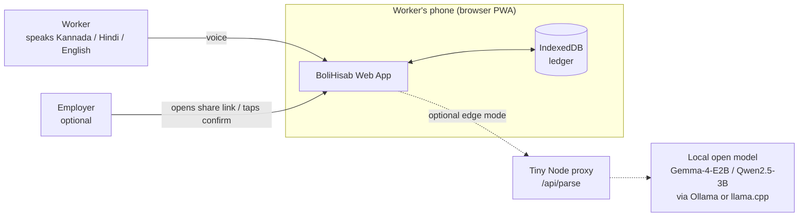
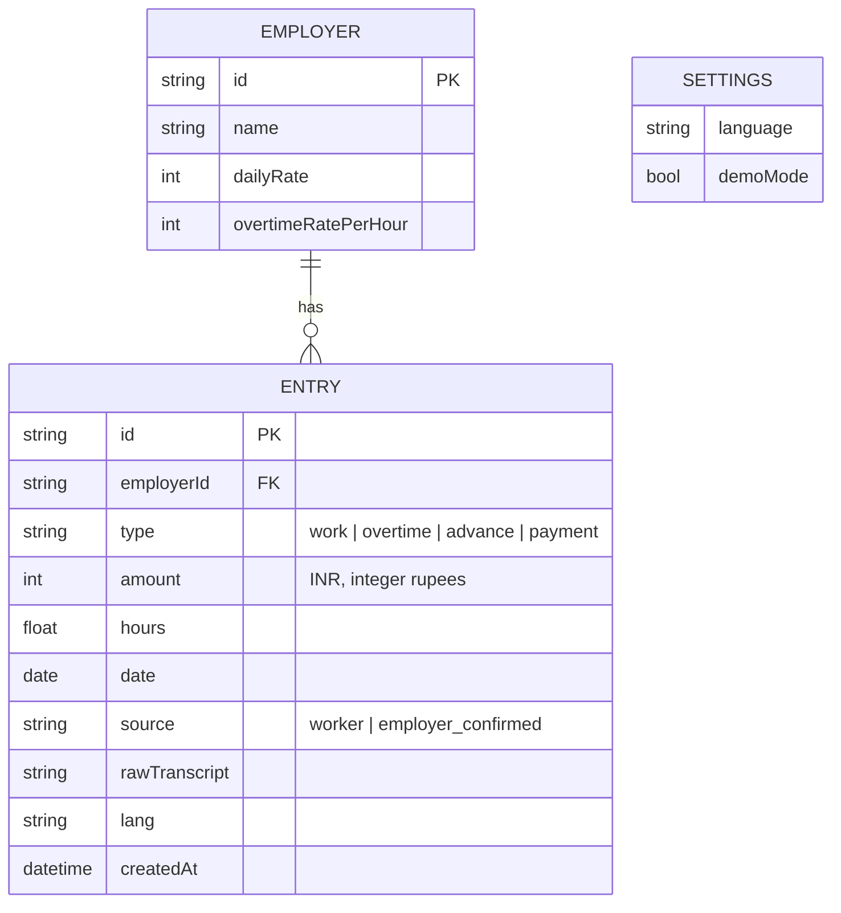

# BoliHisab – Architecture

## 1. System context



Everything works offline-first on the device. The local model server is an **optional enhancement**, never required. No closed API, no keys, no per-call cost, so the same stack can run on an edge device.

## 2. Voice pipeline (the core flow)

```mermaid
sequenceDiagram
    participant U as Worker
    participant UI as Mic UI
    participant STT as Speech-to-Text<br/>(Web Speech API)
    participant NLU as Parser<br/>(rules; LLM if key present)
    participant DM as Dialogue Manager
    participant TTS as Text-to-Speech<br/>(speechSynthesis)
    participant L as Ledger (IndexedDB)

    U->>UI: tap mic, speak
    UI->>STT: start (lang = hi-IN / kn-IN / en-IN)
    STT-->>DM: transcript + confidence
    alt confidence low or noisy
        DM->>TTS: "Please say that again"
    else ok
        DM->>NLU: transcript
        NLU-->>DM: draft Entry {type, employer, date, amount, hours...}
        alt missing / ambiguous field
            DM->>TTS: spoken follow-up question
            U->>STT: answer
            STT-->>DM: merge into draft
        end
        DM->>TTS: read-back "Ramesh, today, 700 rupees. Save?"
        U->>STT: "yes" / "no" / correction
        alt confirmed
            DM->>L: save Entry (source = worker)
            DM->>TTS: "Saved"
        else rejected
            DM->>DM: discard or re-ask
        end
    end
```

Queries ("How much does Ramesh owe me?") skip confirmation: NLU returns a `Query` intent, the Ledger Engine computes the answer, and TTS speaks it.

## 3. Component layers

```
┌───────────────────────────── UI (React) ─────────────────────────────┐
│ Home dashboard │ Voice screen │ Ledger │ Employers │ Payments │ Settings │
└───────────────┬──────────────────────────────────────────────────────┘
                │
┌───────────────▼──────────────── Voice layer ─────────────────────────┐
│ SpeechInput (STT)   SpeechOutput (TTS)   DialogueManager (state machine) │
└───────────────┬──────────────────────────────────────────────────────┘
                │
┌───────────────▼──────────────── Intelligence ────────────────────────┐
│ Normalizer (numerals, number-words, dates) → RuleParser ─┐            │
│                                             LLMParser ───┴→ Validator │
└───────────────┬──────────────────────────────────────────────────────┘
                │
┌───────────────▼──────────────── Domain ──────────────────────────────┐
│ LedgerEngine (balances, overtime)   QueryEngine   StatementBuilder    │
└───────────────┬──────────────────────────────────────────────────────┘
                │
┌───────────────▼──────────────── Persistence / Output ────────────────┐
│ Dexie (IndexedDB)   Seed/Demo data   jsPDF   Web Share / share link   │
└──────────────────────────────────────────────────────────────────────┘
```

## 4. Data model



Balance for an employer = (work wages + overtime) − (advances + payments).

## 5. Key decisions

| Decision | Choice | Why |
|---|---|---|
| Client | React + TypeScript + Vite PWA | Fast to build, installable, mobile-first |
| Speech | Browser Web Speech API | No keys, supports `kn-IN`, `hi-IN`, `en-IN` in Chrome/Android |
| Parsing | Rule-based default, optional local open LLM (Gemma-4-E2B, backup Qwen2.5-3B) | Repo runs with no secrets; small open model is cheap and edge-deployable; LLM handles messy mixed-language |
| Hallucination guard | Amount must appear in transcript, JSON-constrained, temp 0 | Small models invent values; this blocks them before confirm |
| Storage | IndexedDB via Dexie | Persistent, offline, no backend |
| PDF | jsPDF in browser | No server needed |
| Money | Integer rupees | No float errors |
| Safety | Mandatory read-back + confirm | Never save a wrong amount |
| Fallback | Typed/tap input and Demo mode | Judges on non-Chrome or noisy rooms still see it work |
